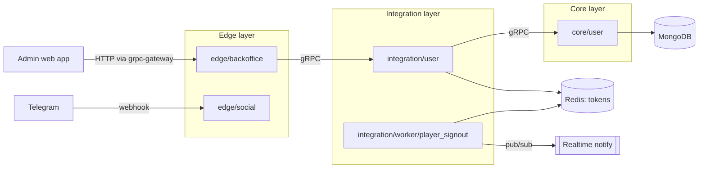
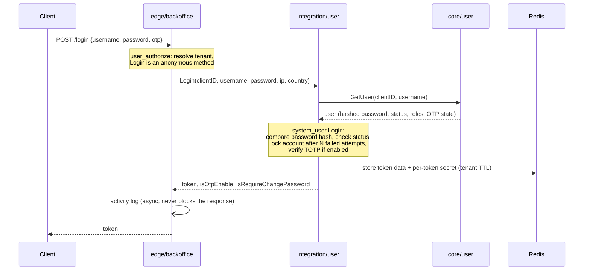

# go-microservice-structure

A reference layout for a Go microservice platform, extracted from a production system. Business domains have been removed; what remains is one end-to-end vertical slice — **backoffice login and admin-user management** — plus a background worker, showing the **architecture, conventions and shared building blocks**.

## Architecture



| Layer | Responsibility | In this repo |
|---|---|---|
| **edge** | Public entry points. Authenticates the request, checks permissions, builds the request context and forwards to integration. No business rules. | `edge/backoffice` (admin API), `edge/social` (Telegram webhook) |
| **integration** | Use-case orchestration: combines core services, Redis tokens and config into a business flow (login, OTP, password policy…). | `integration/user` |
| **integration/worker** | Scheduled background jobs, safe to run with many replicas. | `integration/worker/player_signout` |
| **core** | One bounded domain. Owns its MongoDB collections and exposes data RPCs. Never calls other core services. | `core/user` |

## Walkthrough: login



Every following call carries the token; `edge/pkg/feature/user_authorize` runs before each handler:

1. Resolve the tenant (`clientID`) from request headers.
2. Allow anonymous methods (login, OTP reset) straight through.
3. Load the token data from Redis and check it belongs to the caller.
4. Block the call until OTP is verified, if OTP is required.
5. Check the method's required permission task against the user's tasks (`permission.Task.*`).

Permissions are declared per RPC in one place, `edge/backoffice/cmd/serve.go`.

## Repository layout

```
service/
├── pkg/                          # Generic libraries, no business logic
│   ├── jwt_helper/  password/  encrypt/  validator/
│   ├── rate_limiter/             #   Redis-backed rate limiting
│   ├── scheduler_lock/           #   Distributed lock for cron-style workers
│   ├── notify/                   #   Realtime push via Redis pub/sub (pluggable senders)
│   ├── global_conf/              #   Platform-wide config in MongoDB (hot-reloaded)
│   └── module/  random/  time_function/ ...
└── app/
    ├── pkg/                      # Shared by every app service
    │   ├── shared_conf/          #   Per-tenant config + tenant database lookup
    │   └── module/               #   background_job, redis cache, fast_http ...
    ├── core/user/
    ├── integration/
    │   ├── pkg/
    │   │   ├── feature/person/user/system_user/   # login, OTP, password policy
    │   │   ├── feature/person/user/token_user/    # token store in Redis
    │   │   └── otp/                               # TOTP generation / verification
    │   ├── user/
    │   └── worker/player_signout/
    └── edge/
        ├── pkg/feature/user_authorize/            # authentication + permission middleware
        ├── backoffice/
        └── social/
```

### Anatomy of a service

Every service has the same shape, so a new one can be started by copying an existing one:

```
<service>/
├── main.go                  # Injects build revision, calls cmd.Execute()
├── cmd/                     # cobra commands: serve, version
├── internal/
│   ├── handler/             # gRPC handlers, one file per RPC
│   ├── adapter/             # proto <-> domain model mapping
│   ├── db/                  # Repository layer (core services only)
│   ├── global/              # gRPC clients to downstream services
│   └── pkg/
│       ├── local_conf/      # Service-specific config
│       └── error_helper/    # Typed service errors
├── config.example.ini       # Copy to config.<env>.ini
├── run.yml                  # Docker Swarm stack definition
└── test/
```

## Key design decisions

- **gRPC first, HTTP for free.** Services implement protobuf interfaces, and `grpc-gateway` exposes the same handlers as REST. The API has a single source of truth.
- **Strict layering.** Edge only talks to integration, and integration to core. Core services never call each other, so each domain can be scaled and changed on its own.
- **Three levels of configuration.** `global_conf` (platform) → `shared_conf` (tenant) → `local_conf` (service). Config lives in MongoDB and is hot-reloaded through change streams, so no restart is needed. `.ini` files only hold bootstrap settings (port, DB/Redis addresses, secrets).
- **Multi-tenant by design.** Each tenant (`clientID`) has its own database (`app_client_<id>`), and every config lookup is keyed by tenant.
- **Revocable JWTs.** Each token is signed with its own random secret, stored in Redis with the session data (roles, tasks, OTP state). Logout or locking a user deletes the entry, which revokes the token immediately. The edge layer reads permissions from Redis, so it needs no call to the user service on each request.
- **Security policies as config.** Password rules, username rules and blacklist, max failed logins, OTP issuer and token TTL are all per-tenant config. They are injected into `system_user` as functions (`FnGet*`), so the feature package stays free of config plumbing.
- **Safe horizontal scaling for workers.** `scheduler_lock` (Redis) makes a job run once per tenant per interval, even with several replicas.
- **Non-blocking side effects.** Activity logging goes through the `activity.Log` interface, wrapped in `background_log`, which runs the write in a goroutine. The sink can be swapped (logger, DB, queue) without touching handlers.
- **Graceful shutdown.** Each service registers shutdown hooks to close config watchers and Mongo connections.

## Build & deploy

```bash
make build service=service/app/core/user env=stag
```

`make build` compiles a static Linux binary, builds a Docker image tagged with the git revision and pushes it to the configured registry. `run.yml` deploys the service to Docker Swarm with resource limits and rolling updates.

## Note

The original platform depends on two private modules, `go-pkg` (logging, gRPC server, Mongo/Redis clients, scheduler) and `proto-repo` (generated protobuf code). They are referenced through `replace` directives in `go.mod` and are **not included**, so this repository is meant for reading the structure rather than running as-is. Service structs embed the generated `Unimplemented…Server`, so RPCs whose business handlers were stripped from this sample return `codes.Unimplemented`.
